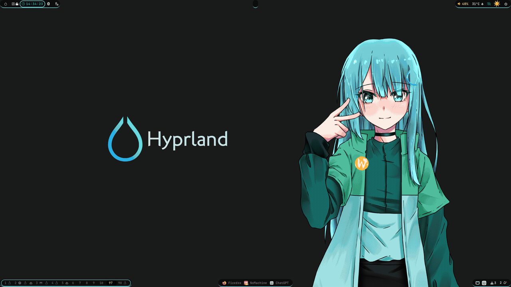

# hyprnerd

[](https://github.com/hama6767/hyprnerd/actions/workflows/ci.yml)

Reproducible KooL-inspired Hyprland 0.57 dotfiles, with a faithful Arch appearance port for Ubuntu.




Actual Hyprland desktop capture using temporary demo windows. The GIF is 8 seconds at 1280×720 (about 1 MB); it shows tiled windows, the floating-mode switch, Dock reveal and hiding, and window closing.

個人用Arch環境の **JaKooLit v2.3.17の実際の見た目**を、Ubuntu 24.04 / Hyprland 0.57.2のLua設定へ移植したdotfilesです。新しいKooLの既定テーマではなく、参照機の壁紙・生成済み配色・透過率・実効フォントを収録しています。現在のレイアウトは上部Waybarと自動非表示Dockです。元の上下バー設定も同梱しています。

設定の土台は LinuxBeginnings/Hyprland-Dots `170b69b846b1cd92ebc6d81c17393e17bed8d416`（v2.3.28.3）。バージョン、QtパッケージURLとSHA-256は `dependencies.lock.json` に固定しています。設定・壁紙・フォント・GTK/Qtテーマ・アイコンは `home/` に含むため、参照PCへのSSH接続は不要です。これはデスクトップ設定の再現用で、OSやHyprland自体のインストーラではありません。

## 再適用

まず `git clone https://github.com/hama6767/hyprnerd.git && cd hyprnerd` で取得します。既存のHyprland 0.57.xセッションで、リポジトリのルートから実行します。インストール先は実行ユーザーのホームです。sudoは使用しません。

```bash
# Linux x86_64: 公式KittyをSHA-256照合してユーザー領域へ配置（Ubuntuの旧版より起動が速い）
python3 scripts/install-kitty.py

# Ubuntu 24.04 amd64: Qt5/Qt6用プラグインを取得・SHA-256照合してユーザー領域に配置
python3 scripts/install-qt-plugins.py

# このUbuntuデスクトップ（NVIDIA、ee/us、HDMI-A-1）用
python3 install.py --profile ubuntu-desktop --check
python3 install.py --profile ubuntu-desktop --apply

# 違うPC: 既存のUserConfigsの入力・モニター設定を引き継ぐ
python3 install.py --profile generic --check
python3 install.py --profile generic --apply
```

`--check` は差分表示だけです。`--apply` は変更する設定を `~/.local/state/kool-dotfiles/backups/日時/` に保存してから適用し、構文を検証し、壁紙・バー・Dock・通知・Kittyを再読み込みします。ログアウトしません。既に起動しているGTK/Qtアプリの一部は、次回起動から新しいテーマとフォントを読み込みます。

汎用プロファイルで既存のHyprland設定が別形式の場合は、最初に `home/.config/hypr/UserConfigs/user_settings.lua` と `monitors.lua` を編集してください。`ubuntu-desktop` プロファイルは別PCにそのまま適用しないでください。

## デスクトップ操作

標準はタイル表示です。上部バーの `Tile` / `Window` をクリックすると、通常ウィンドウ全体をタイル／自由配置へ切り替えます。選んだモードは再起動後も保持します。ダイアログやスクラッチパッドなど、元から浮動表示するウィンドウは維持します。自由配置では新しいウィンドウも浮動表示になります。

| 操作 | キー／マウス |
|---|---|
| ターミナルを開く | `Super+Enter`（Kittyの共有プロセスを再利用） |
| タイル／自由配置を切り替え | `Super+Alt+Space`、またはバーの `Tile` / `Window` |
| 現在のウィンドウだけ浮動を切り替え | `Super+Space` |
| 自由配置で移動／サイズ変更 | `Super+左ドラッグ` / `Super+右ドラッグ` |
| 前／次のデスクトップ（全モニター） | `Super+Ctrl+←/→`、`Super+Shift+Tab` / `Super+Tab`、バー中央でスクロール |
| 番号で切り替え | `Super+1…0`（1〜10） |
| ウィンドウを移して追従／移動だけ | `Super+Shift+1…0` / `Super+Ctrl+1…0` |
| 前／次へウィンドウを移して追従 | `Super+Shift+[` / `Super+Shift+]` |
| デスクトップを追加 | `Super+Ctrl+N`、またはバー中央の `+` |
| 一覧から選択／ウィンドウ移動 | バー中央の番号を左／右クリック |
| Dockを表示 | 各画面の下端中央にカーソルを近づける。離すと隠れる |
| Dockの有効／無効 | `Ctrl+Alt+D`（状態を保存） |

デスクトップ番号ごとに、接続中の各モニターのワークスペースを1組として切り替えます。11以上も矢印や追加ボタンで作成できます。空になった非表示ワークスペースはHyprlandに従って消え、一覧も追従します。モニター数は固定せず、追加時は同じ番号に合流し、取り外した画面のウィンドウは残った画面へ移します。Dockから別のワークスペースのアプリを開いた場合も全画面を同期します。

`Super+Enter` はKittyの共有プロセスでウィンドウを追加し、フォント・GPUキャッシュを再利用します。KooLのウィンドウアニメーションは維持します。ROS・Atuin・Fastfetchの初期化は保持します。公式Kitty 0.51.1は `scripts/install-kitty.py` でチェックサムを照合し、`~/.local/opt/hyprnerd-kitty/` へ配置します。既存の `~/.local/bin/kitty` / `kitten` は置換前にバックアップします。OS付属版と既に開いているウィンドウは維持します。

Dockのアイコンは起動・切り替えに使用し、右クリックでピン留めできます。ホットスポットはモニター増減時に再生成します。Dockは画面領域を予約しないため、タイル表示は下端まで使えます。設定は `UserConfigs/user_desktop.lua`、DockのCSSは `~/.config/nwg-dock-hyprland/`、実行時のモードは `~/.local/state/hyprnerd/` に保存します。

## 復元

適用時に表示された `BACKUP:` のディレクトリを指定します。ファイル・ディレクトリ・元のシンボリックリンク・GTKのGSettingsを復元します。

```bash
python3 install.py --restore ~/.local/state/kool-dotfiles/backups/日時 --check
python3 install.py --restore ~/.local/state/kool-dotfiles/backups/日時
```

KittyやQtプラグインなどの追加ランタイムは残りますが、復元した設定では参照されなくなります。既存のNeovim/LazyVim、ROS、Atuin、NoMachineの起動ラッパーはこのリポジトリの置換対象に含めません。BashにはKitty内だけで働く表示用フックを追加し、既存の設定を保持します。

## 再現する値

| 項目 | 値 |
|---|---|
| 壁紙 | `wall_anime_4K.png`、SHA-256 `6ea87df130eeb91675eafa7af3748afff62efed71d10347fae2d5b0b430d570b` |
| バー・Dock | `Hyprnerd-Desktop` 上部30px、下部に自動非表示Dock（40pxアイコン）。参照配色を維持 |
| 基本色 | 背景 `#191919`、文字 `#FCF6F3`、枠 `#72C8C8`、非アクティブ枠 `#18615F`、アクセント `#FDB417` |
| ウィンドウ | 枠2px、角丸10px、内側余白6px・外側8px |
| ぼかし・影 | blur size6 / passes2、shadow range3 / power1 |
| 共通透過率 | active 1.0 / inactive 0.9 / fullscreen 1.0 |
| Firefox | active 0.9 / inactive 0.7（共通値に乗算、非アクティブの実効値0.63） |
| Kitty | active 0.8 / inactive 0.7、背景opacity 0.9（背景の実効値0.72 / 0.567） |
| Kittyフォント | Noto Sans Mono 12pt。参照側のFantasque指定は未インストールで、このフォントにフォールバックしていた |
| バー・メニュー | JetBrainsMono Nerd Font。バーbold 97%、Rofi SemiBold 15 / 13 |
| GTK | Kali-Dark、Adwaita Sans 11、Flat-Remix-Blue-Dark、Adwaita cursor 24 |
| Qt | Kvantum `catppuccin-mocha-blue`、Fira Code Medium 14（固定幅12） |

アプリ別の全ルールは `home/.config/hypr/UserConfigs/user_window_rules.lua` にあります。Ubuntu Snap版Firefoxのクラス `firefox_firefox` とDolphinのクラスを追加しています。`override` を使わず、参照側と同じ透過率の乗算を維持します。

参照壁紙のハッシュが一致するときだけ、`reference-palette/` の配色を復元します。同じ壁紙でもWallustの版や抽出結果によって色が変わる問題を防ぎます。他の壁紙に切り替えた場合は通常のWallust生成が動きます。

デスクトップ機にはノートPCのバッテリーと内蔵バックライトがないため、その2モジュールは表示しません。Caps Lock表示は入力デバイスへの権限を追加せずsysfsのLEDから取得します。CPU温度センサーはインストール時に選びます。Archの更新数表示はUbuntuのAPTキャッシュに置換し、自動的なパッケージ更新は行いません。

## 依存関係

必須: Hyprland **0.57.x**、Python3、Kitty（検証0.51.1）、nwg-dock-hyprland **0.4.11**、Waybar（検証0.16.0）、Rofi、SwayNotificationCenter、jq、gsettings、fontconfig、awww/awww-daemon、Qt5/Qt6のKvantum。Ubuntu用プラグインにはQt5.15 / Qt6.4、QtSvg、KF5WindowSystem、Qt5X11Extrasのランタイムが必要です。`install-qt-plugins.py` はリンク先の不足を `ldd` で検査します。

メニュー・ショートカットで使用する補助ツール: wallust、fastfetch、wlogout、hyprlock、hypridle、hyprsunset、grim、slurp、swappy、wl-clipboard、cliphist、playerctl、pamixer、pavucontrol、brightnessctl、bc、yad、notify-send、nm-applet/nmcli、blueman-manager、nwg-look、Quickshell (`qs`)、Dolphin、Firefox、Neovim。これらのOSパッケージや独自配布バイナリは別途準備してください。検証機のパッケージ版は `docs/installed-packages.tsv` に記録しています。

Dockはディストリビューションのパッケージ、または [nwg-dock-hyprland v0.4.11](https://github.com/nwg-piotr/nwg-dock-hyprland/tree/v0.4.11) のソースから導入してください。ソースビルドにはGo、GTK3開発ファイル、gtk-layer-shell開発ファイルが必要です。ビルドした `nwg-dock-hyprland` を `~/.local/bin/` などPATH内に配置します。`install.py --check` は不足を検出します。

Ubuntu向けQtプラグイン取得はAPTソースを追加しません。Archなどでは、そのOSの `kvantum` / `qt5ct` / `qt6ct` パッケージを利用してください。NVIDIA設定とNoMachineの子プロセス向けLD_PRELOAD除去は `hosts/ubuntu-desktop/user_env.lua` に分離しています。ML4W由来のQt同梱版Quickshellが存在する場合は専用ラッパーでシステムQtプラグインから分離します。

上流の任意TUIバイナリ（dots-tui）は含めません。Rofiのクイック設定を利用します。固定プロファイルを上流更新で上書きしないよう、バーのdotfiles更新ボタンはGitによる更新手順を案内します。

## 検証・変更

```bash
python3 scripts/validate.py
python3 install.py --profile ubuntu-desktop --check
```

検証記録は `docs/validation.json`、プレビューは `docs/preview.png`。変更後はチェックしてから再適用します。生成色の原本は `reference-palette/`、ホスト依存値は `hosts/`、その他のdotfilesは `home/` です。

## 出典

- [LinuxBeginnings / Hyprland-Dots](https://github.com/LinuxBeginnings/Hyprland-Dots/tree/170b69b846b1cd92ebc6d81c17393e17bed8d416): Lua設定、スクリプトとKooL資材（GPL-3.0）。
- [JaKooLit / Hyprland-Dots](https://github.com/JaKooLit/Hyprland-Dots): 参照環境のバー、Rofi、ターミナル構成。
- [Kvantum](https://github.com/tsujan/Kvantum): Qt Widgetsテーマエンジン。Ubuntu Qt6パッケージは公式導入案内に記載されたPapirus PPAより取得。
- [Flat Remix](https://github.com/daniruiz/flat-remix)、[Catppuccin Kvantum](https://github.com/catppuccin/kvantum)、Kali-Dark、Adwaita/Noto/Fira/JetBrains/Victorフォントは各作者の資材です。取得できたライセンス本文を `licenses/` に保持しています。
- 壁紙と参照側テーマはユーザー所有環境から提供された個人用スナップショットです。SSH接続情報や認証情報はこのリポジトリに含めません。

## CI/CD

Pushes and pull requests run Python 3.12/3.13 installer tests, asset checksum/link checks, JSON/TOML validation, and Bash/Lua syntax checks on Ubuntu 24.04. Lua integration tests also cover synchronized desktops, arbitrary workspace counts, monitor hotplug, and floating-mode ownership across reloads. The tests exercise check/apply/idempotency/rollback in temporary homes with simulated desktop commands; they do not modify a live desktop. Live Hyprland visual validation remains a separate `scripts/validate.py` check.

Successful `main` builds upload a `hyprnerd` archive and SHA-256 checksum as Actions artifacts. Pushing a semantic version tag such as `v0.2.0` reruns the same checks and publishes a GitHub Release with the archive and checksum. Release archives are generated from tracked Git files, including dotfiles and symlinks, and exclude local caches and credentials. Releases do not apply settings to anyone's computer automatically.

```bash
python3 scripts/ci.py
python3 -m unittest discover -s tests -v
python3 scripts/package.py --version 0.2.0
# After committing and pushing main, publish a release:
git tag v0.2.0
git push origin v0.2.0
```

GitHub Actions are pinned to commit SHAs and updated through monthly Dependabot pull requests. Validation jobs have read-only repository access; only the tag release job has `contents: write`.

## Licensing

The installer, integration code, and KooL-derived configuration are distributed under GPL-3.0-or-later; see `LICENSE`. Third-party fonts, icons, themes, and artwork retain their own licences and copyright. `THIRD_PARTY.md` records their provenance; the repository-wide code licence does not relicense those assets.
