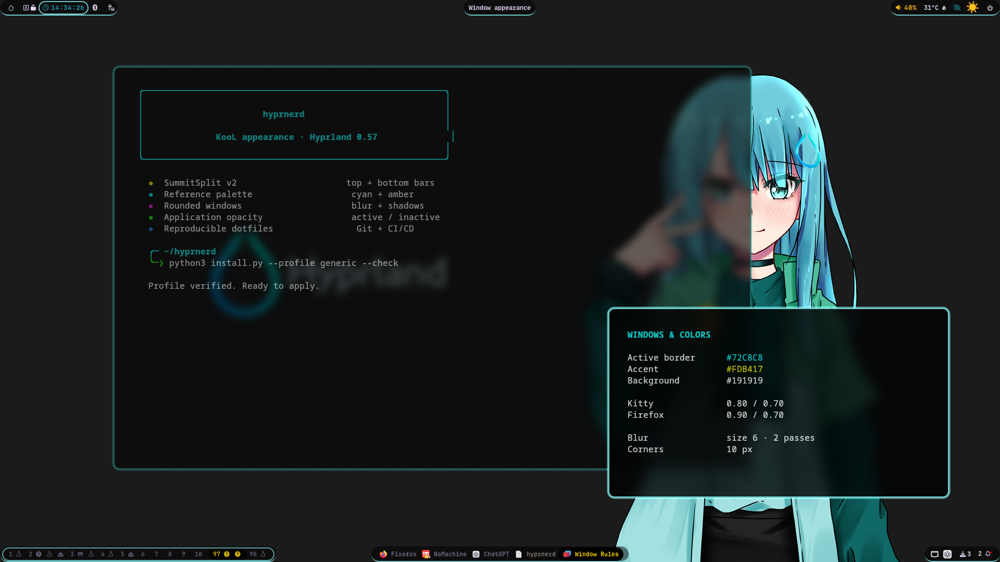

# hyprnerd

[](https://github.com/hama6767/hyprnerd/actions/workflows/ci.yml)

Arch 環境（JaKooLit v2.3.17）の見た目を Ubuntu 24.04 / Hyprland 0.57.2 の Lua 設定へ再現した dotfiles です。




- **再現性重視**: 壁紙・配色・フォント・GTK/Qt テーマを `home/` に同梱し、バージョンとハッシュを `dependencies.lock.json` で固定
- **非破壊**: `sudo` 不要。既存の Neovim / ROS / Atuin 等の設定は上書きせず、適用前に自動バックアップ
- **対象外**: OS や Hyprland 本体のインストーラではありません（既存の Hyprland 0.57.x 環境向け）

## セットアップ / 再適用

リポジトリを取得し、Hyprland セッション上から実行します。

```bash
git clone [https://github.com/hama6767/hyprnerd.git](https://github.com/hama6767/hyprnerd.git) && cd hyprnerd

# 任意: 公式 Kitty（x86_64）および Ubuntu 24.04 向け Qt5/Qt6 プラグインをユーザー領域へ導入
python3 scripts/install-kitty.py
python3 scripts/install-qt-plugins.py

# 汎用 PC（既存の入力・モニター設定を引き継ぐ）
python3 install.py --profile generic --check
python3 install.py --profile generic --apply

# 専用デスクトップ（NVIDIA / ee,us / HDMI-A-1）※別 PC には使用しないこと
python3 install.py --profile ubuntu-desktop --check
python3 install.py --profile ubuntu-desktop --apply
```

- `--check` は差分表示のみ。`--apply` は `~/.local/state/kool-dotfiles/backups/<日時>/` へ退避後、構文検証してログアウトせずに即時反映します。
- `generic` で既存設定の形式が異なる場合は、先に `home/.config/hypr/UserConfigs/user_settings.lua` と `monitors.lua` を編集してください。

## 主な操作

上部 Waybar の `Tile` / `Window` で全体のタイル／自由配置を切り替えられます（再起動後も保持）。ワークスペースは全モニター連動で切り替わり、画面下端中央へのカーソル移動で自動非表示 Dock が現れます。

| 操作 | キー／マウス |
|---|---|
| ターミナルを開く（共有プロセス再利用） | `Super+Enter` |
| 全体のタイル／自由配置を切り替え | `Super+Alt+Space` / バーの `Tile`・`Window` |
| 現在のウィンドウのみ浮動切り替え | `Super+Space` |
| ウィンドウの移動／サイズ変更 | `Super+左ドラッグ` / `Super+右ドラッグ` |
| 前／次のデスクトップ（全モニター） | `Super+Ctrl+←/→`、`Super+Shift+Tab` / `Super+Tab`、バー中央スクロール |
| 番号で切り替え（1〜10） | `Super+1…0` |
| ウィンドウを移動（追従／移動のみ） | `Super+Shift+1…0` / `Super+Ctrl+1…0` |
| 前／次へウィンドウを移動（追従） | `Super+Shift+[` / `Super+Shift+]` |
| デスクトップを追加 | `Super+Ctrl+N` / バー中央の `+` |
| 一覧から選択／ウィンドウ移動 | バー中央の番号を左／右クリック |
| Dock の有効／無効を切り替え | `Ctrl+Alt+D` |

## 復元

適用時に表示される `BACKUP:` パスを指定すると、設定ファイル・シンボリックリンク・GTK GSettings を元に戻せます。

```bash
python3 install.py --restore ~/.local/state/kool-dotfiles/backups/<日時> --check
python3 install.py --restore ~/.local/state/kool-dotfiles/backups/<日時>
```

## 依存関係

- **必須**: Hyprland `0.57.x`, Python 3, Kitty（`0.51.1` 検証済）, `nwg-dock-hyprland` `0.4.11`, Waybar（`0.16.0` 検証済）, Rofi, SwayNotificationCenter, `jq`, `gsettings`, `fontconfig`, `awww`, Kvantum（Qt5/Qt6）
  - Ubuntu で `install-qt-plugins.py` を使う場合は Qt5.15 / Qt6.4、QtSvg、KF5WindowSystem、Qt5X11Extras のランタイムが必要です（Arch 等では OS パッケージを使用）。
  - `nwg-dock-hyprland` はパッケージまたは [v0.4.11](https://github.com/nwg-piotr/nwg-dock-hyprland/tree/v0.4.11) からビルドして PATH 内に配置してください。
- **補助ツール**: `wallust`, `fastfetch`, `hyprlock`, `grim`, `slurp`, `cliphist`, `Quickshell` 等は必要に応じて導入してください（検証環境の全パッケージは `docs/installed-packages.tsv` を参照）。

## 構成と再現仕様

```text
home/               dotfiles 本体・壁紙・フォント・テーマ・アイコン
hosts/              ホスト固有設定（NVIDIA 環境変数など）
reference-palette/  参照壁紙一致時に使う固定配色
scripts/            導入・検証・CI・パッケージング用スクリプト
```

<details>
<summary>再現する見た目・設定値の詳細</summary>

| 項目 | 値 |
|---|---|
| 壁紙 | `wall_anime_4K.png`（ハッシュ一致時のみ固定配色を適用、変更時は Wallust 生成） |
| バー・Dock | 上部 Waybar 30px / 下部自動非表示 Dock（40px、画面領域非予約） |
| 基本色 | 背景 `#191919` / 文字 `#FCF6F3` / 枠 `#72C8C8` / 非アクティブ `#18615F` / アクセント `#FDB417` |
| ウィンドウ | 枠 2px / 角丸 10px / gaps in 6px・out 8px / blur 6×2 / shadow 3・power 1 |
| 透過率 | 共通 `1.0 / 0.9`・Firefox `0.9 / 0.7`（乗算）・Kitty `0.8 / 0.7`（背景 `0.9`） |
| フォント | Kitty: Noto Sans Mono 12pt / バー・Rofi: JetBrainsMono Nerd Font |
| GTK / Qt | Kali-Dark + Flat-Remix-Blue-Dark / Kvantum `catppuccin-mocha-blue` + Fira Code |

アプリ別ルールと詳細設定は `home/.config/hypr/UserConfigs/user_window_rules.lua` および `user_desktop.lua` を参照してください。

</details>

## 検証・開発・リリース

Push / PR ごとに GitHub Actions でインストーラのテスト（チェック・適用・冪等性・復元）、Lua/Bash 構文検証、ハッシュ整合性チェックを実行します。タグ（`v*`）を push するとアーカイブとチェックサム付きで GitHub Release を公開します。

```bash
python3 scripts/validate.py               # 実環境チェック（記録: docs/validation.json）
python3 scripts/ci.py                     # CI 検証一式
python3 -m unittest discover -s tests -v  # ユニットテスト
python3 scripts/package.py --version 0.2.0
```

## 出典・ライセンス

- **コード・設定**: GPL-3.0-or-later（`LICENSE`）。ベースは [LinuxBeginnings/Hyprland-Dots](https://github.com/LinuxBeginnings/Hyprland-Dots/tree/170b69b846b1cd92ebc6d81c17393e17bed8d416)（v2.3.28.3）および [JaKooLit/Hyprland-Dots](https://github.com/JaKooLit/Hyprland-Dots)。
- **サードパーティ資材**: Kvantum、Flat Remix、Catppuccin Kvantum、Kali-Dark、各フォントおよび壁紙は元のライセンスに従います（詳細は `THIRD_PARTY.md` および `licenses/`）。
